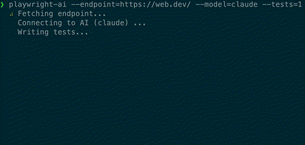

# playwright-ai [](https://www.npmjs.com/package/playwright-ai)

> Command-line utility that generates [Playwright](https://playwright.dev/) end-to-end tests for a web page with Claude or OpenAI models.


Point it at a URL. It renders the page, hands the cleaned DOM to a model, writes one spec file per UI component into your Playwright project, runs each spec, and asks the model to repair anything that fails.



## Requirements

- Node.js 22.13 or newer
- A Playwright project (`npm init playwright@latest`) in the directory you run the CLI from
- An API key for the model you want to use:
  - Anthropic: set `ANTHROPIC_API_KEY` (or sign in with `ant auth login`)
  - OpenAI: set `OPENAI_API_KEY`

## Quick start

```sh
npm install -g playwright-ai

cd my-playwright-project
export ANTHROPIC_API_KEY=sk-ant-...
playwright-ai --endpoint https://example.com --tests 3
```

The CLI detects `playwright.config.{ts,js}`, writes specs to its `testDir` (default `./tests`), and writes TypeScript when your config or project is TypeScript. Passing tests are listed with ✔, failing ones with ✖ so you can finish them by hand.

## Options

| Option               | Alias | Default  | Description                                                         |
| -------------------- | ----- | -------- | ------------------------------------------------------------------- |
| `--endpoint <url>`   | `-e`  | required | Page to generate tests for                                          |
| `--tests <n>`        | `-t`  | `1`      | Number of components to cover                                       |
| `--model <id>`       | `-m`  | `claude` | Model id or alias, see below                                        |
| `--provider <name>`  | `-p`  | inferred | `anthropic` or `openai`, for custom model ids                       |
| `--fix-attempts <n>` | `-f`  | `2`      | Repair rounds for a failing spec                                    |
| `--no-run`           |       |          | Write specs without running them                                    |
| `--no-render`        |       |          | Fetch raw HTML instead of rendering the page in Chromium            |
| `--language js\|ts`  | `-l`  | detected | Spec file language                                                  |
| `--test-dir <dir>`   |       | detected | Where to write specs                                                |
| `--focus <name...>`  |       |          | Component hints, e.g. `--focus "login form" navigation`             |
| `--project <name>`   |       |          | Playwright project to run specs with                                |
| `--overwrite`        |       | `false`  | Replace an existing spec with the same name instead of suffixing it |
| `--max-html <chars>` |       | `60000`  | Cap on cleaned HTML sent to the model                               |
| `--report <file>`    | `-r`  |          | Write a JSON report of the run                                      |
| `--dry-run`          |       |          | Show the cleaned HTML and settings without calling a model          |
| `--verbose`          | `-v`  |          | Plain-text progress output                                          |

Exit code is `0` when every generated spec passes, `2` when some failed, and `1` on errors.

### Models

| `--model` value               | Resolves to              |
| ----------------------------- | ------------------------ |
| `claude`, `anthropic`, `opus` | `claude-opus-5-5`        |
| `sonnet`                      | `claude-sonnet-5-5`      |
| `haiku`                       | `claude-haiku-5-5`       |
| `openai`, `gpt`               | `gpt-5.5`                |
| any `claude-*` id             | that model via Anthropic |
| any `gpt-*` / `o*` id         | that model via OpenAI    |

Anthropic requests use prompt caching for the page HTML across turns and opt into server-side refusal fallbacks on models that support them.

## Examples

Generate three TypeScript specs with Sonnet and keep a report:

```sh
playwright-ai -e https://shop.example.com -t 3 -m sonnet -r reports/shop.json
```

Only write files, no browser runs, for a page that needs no rendering:

```sh
playwright-ai -e https://docs.example.com --no-run --no-render
```

Target specific components first:

```sh
playwright-ai -e https://app.example.com -t 2 --focus "sign in form" "main navigation"
```

Inspect what the model would see:

```sh
playwright-ai -e https://example.com --dry-run | less
```

### Debug logging

```sh
DEBUG=playwright-ai:* playwright-ai -e https://example.com
```

## How it works

1. **Inspect** the current directory for a Playwright config, test directory and language.
2. **Fetch** the page. When Playwright is installed, the page is rendered in headless Chromium so client-side apps produce real markup. Scripts, styles, SVG paths, inline handlers and base64 blobs are stripped before the HTML is sent to the model.
3. **Generate** one spec per component in a single multi-turn conversation, so later components avoid repeating earlier ones.
4. **Run** each spec with `npx playwright test`. Failures are fed back to the model for up to `--fix-attempts` repair rounds.
5. **Report** the outcome on the terminal and optionally as JSON.

## Programmatic use

```js
import { fetchHTML } from "playwright-ai/lib/html.js";
import { generateTests } from "playwright-ai/lib/generator.js";
import { createProvider } from "playwright-ai/lib/providers/index.js";

const { html } = await fetchHTML("https://example.com");
const { tests } = await generateTests({
  endpoint: "https://example.com",
  html,
  provider: createProvider({ model: "sonnet" }),
  cwd: process.cwd(),
  testDir: "tests",
  language: "ts",
  count: 2,
});
```

## Development

```sh
npm install
npm test          # unit tests (node --test)
npm run test:e2e  # drives a real Playwright run against a local page
npm run lint
```

## Release history

See [CHANGELOG.md](CHANGELOG.md).

## License

[MIT](LICENSE)
